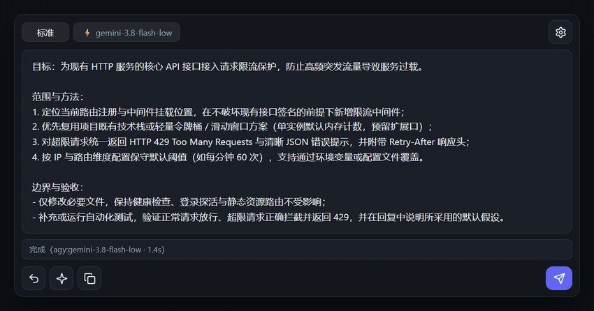
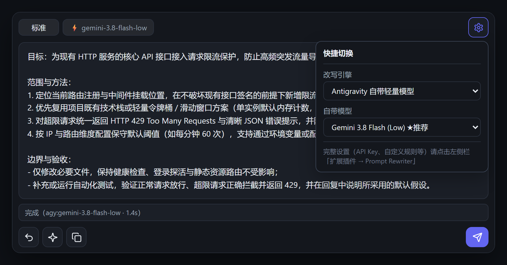
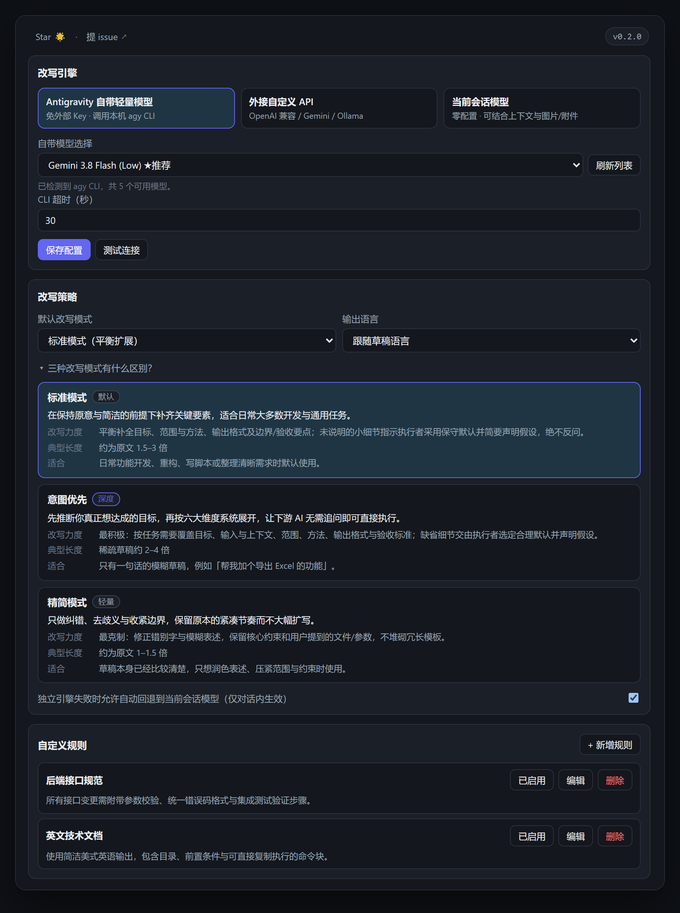

# agy-prompt-rewriter

English · [简体中文](./README.zh-CN.md)

[](./LICENSE)
[](https://antigravity.google)
[](https://nodejs.org/)
[](./package.json)

Turn rough, underspecified one-line drafts into clear, structured, execution-ready prompts inside Google Antigravity. **Rewrite only — never executes tasks, never asks follow-up questions.** Results render in an inline editable card where you can refine text, revert to the original draft (`↩`), or send directly to execute (`➤`).

<p align="center">
  
  <br>
  <sub>Figure 1: In-place editing, undo/redo (↩), quick model switching (⚙), copy (📋), and one-click send (➤)</sub>
</p>

- **Inline Editable Card + Icon Toolbar**: Running `/prompt-rewriter` mounts a compact workbench directly below the reply — no copy-pasting or sidebar switching required.
- **3-Engine Routing + Quick Switcher**: Rewrites with your local `agy` lightweight model by default to preserve main-session quota, or routes to an External API / Current Session model (automatically used when images or `@` attachments are present).
- **Zero Runtime Dependencies**: Pre-built `dist/mcp-server.mjs` and single-file `dist/app.html` are committed — clone and enable with no `npm install`.

```text
Please install and enable the Google Antigravity plugin agy-prompt-rewriter for me:
1. Clone https://github.com/Bzwlc/agy-prompt-rewriter.git into the global plugin directory (~/.gemini/config/plugins/agy-prompt-rewriter on macOS/Linux, or %USERPROFILE%\.gemini\config\plugins\agy-prompt-rewriter on Windows);
2. Run `agy plugin enable agy-prompt-rewriter`;
3. Run `agy plugin validate --strict` to verify the installation and report the result.
```

**Contents**: [Quick Start](#quick-start) · [Purpose](#purpose) · [Usage](#usage) · [Settings and Routing](#settings-and-routing) · [How It Works and Security](#how-it-works-and-security) · [FAQ and Limitations](#faq-and-limitations) · [Development](#development)

---

## Quick Start

Requirements: **Google Antigravity** (`agy` CLI, Desktop 2.0, or IDE) and **Node.js >= 20**.

### Option 1: Let Your AI Assistant Install It (Recommended)

Copy and send the prompt below to Antigravity or any AI coding assistant:

```text
Please install and enable the Google Antigravity plugin agy-prompt-rewriter for me:
1. Clone https://github.com/Bzwlc/agy-prompt-rewriter.git into the global Antigravity plugins directory:
   - macOS / Linux: `~/.gemini/config/plugins/agy-prompt-rewriter`
   - Windows: `%USERPROFILE%\.gemini\config\plugins\agy-prompt-rewriter`
   (If the directory already exists, verify the remote and run `git pull --ff-only`.)
2. Run `agy plugin enable agy-prompt-rewriter`.
3. Run `agy plugin validate --strict <plugin-dir>` to verify the manifest, skill, and MCP bundle.
4. Report the installed path, validation status, and how to test `/prompt-rewriter`.
```

### Option 2: Manual Global Install via Terminal

```bash
# macOS / Linux
git clone https://github.com/Bzwlc/agy-prompt-rewriter.git ~/.gemini/config/plugins/agy-prompt-rewriter
agy plugin enable agy-prompt-rewriter
agy plugin validate --strict ~/.gemini/config/plugins/agy-prompt-rewriter
```

```powershell
# Windows (PowerShell)
git clone https://github.com/Bzwlc/agy-prompt-rewriter.git "$env:USERPROFILE\.gemini\config\plugins\agy-prompt-rewriter"
agy plugin enable agy-prompt-rewriter
agy plugin validate --strict "$env:USERPROFILE\.gemini\config\plugins\agy-prompt-rewriter"
```

> Pre-built `dist/mcp-server.mjs` and `dist/app.html` are committed in the repository, so end users need **zero `npm install`**.

### Other Installation Options

- **Local checkout via CLI**: `agy plugin install /path/to/agy-prompt-rewriter && agy plugin enable agy-prompt-rewriter`
- **Project-scoped**: Copy this folder to `.agents/plugins/agy-prompt-rewriter/` inside your repository.

---

## Purpose

Quick one-line drafts typically lack **Goal, Output Format, and Boundaries**. Sending them straight to your flagship model causes guesswork or back-and-forth clarifying questions, and spending heavy-model context just to polish a draft is inefficient.

`agy-prompt-rewriter` separates prompt refinement into a fast pre-flight step: a lightweight engine structures your intent into an editable card so you can inspect, tweak, and execute cleanly in one shot.

**What you type**

> `/prompt-rewriter Add rate limiting to our API so it doesn't get flooded`

**What lands in the inline card (Standard mode example)**

> Goal: Add request rate limiting to the existing HTTP API endpoints to protect the service from burst traffic and abuse.
>
> Scope & Approach:
> 1. Inspect the existing router and middleware setup and add a rate-limiting middleware without breaking current endpoint signatures;
> 2. Reuse existing project utilities or a lightweight token-bucket / sliding-window limiter (defaulting to in-memory per-instance counters unless a shared store is configured);
> 3. Return HTTP `429 Too Many Requests` with a structured JSON error message and a `Retry-After` header when limits are exceeded.
>
> Boundaries & Verification:
> - Keep changes minimal and leave health-check or static routes exempt (for unspecified thresholds, window sizes, or allowlists, adopt conservative defaults and state your assumptions briefly);
> - Add or run tests verifying normal traffic passes and excessive requests receive `429`.

- **Zero follow-up questions**: `sanitizeRewrittenOutput` strips accidental outer fences, meta prefixes, and trailing questions automatically.

---

## Usage

### 1. Triggers

- Slash command: `/prompt-rewriter <your draft>`
- Natural language: `rewrite this prompt: ...`, `polish this prompt: ...`, `帮我改写提示词：...`, `详细改写 ...`, `精简改写 ...`

### 2. Inline Card Controls (`show_rewriter_card`)

<p align="center">
  
  <br>
  <sub>Figure 2: Inline card with mode/rule dropdown and the anchored ⚙ quick-switch popover</sub>
</p>

| Area | Control | Behavior |
| :--- | :--- | :--- |
| Top bar | Mode / Rule selector | Switch between `Standard`, `Intent-First`, `Concise`, or enabled custom rules |
| Top bar | Engine badge | Displays active engine (`⚡ gemini-3.8-flash-low`, `🌐 gpt-4o-mini`, `💬 Current Session`) |
| Top bar | `⚙` Quick Switcher | Opens an anchored popover (`popover="auto"`) to change engine, built-in model, or default mode on the fly |
| Editor | Auto-sizing `<textarea>` | Edit rewritten output or refine your draft directly |
| Bottom bar | `↩` / `↪` | Revert to initial draft (`↩`) and toggle back to rewritten text (`↪`) |
| Bottom bar | `✨` | Re-run rewriting on current text; click again while running to cancel |
| Bottom bar | `📋` | Copy text to clipboard (`✓` on success) |
| Bottom bar | `➤` | Submit finalized prompt to the active conversation via `app.sendMessage` |

### 3. Mode Comparison (Example: `Write a script to clean up old log files`)

| Mode | Triggers | Expansion | Output Focus |
| :--- | :--- | :--- | :--- |
| **Standard (Default)** | Default / `Standard` | ~`1.5×–3×` | Adds target directory scope, mtime retention threshold, safe `--dry-run` default, and verification steps |
| **Intent-First** | `deep`, `intent-first`, `详细改写`, `意图优先` | ~`2×–4×` | Expands across 6 dimensions: Goal, Inputs & Context, Scope, Approach, Output Format, and Acceptance Criteria |
| **Concise** | `concise`, `精简改写`, `简短改写` | ~`1×–1.5×` | Keeps phrasing tight while locking down core safety constraints and retention rules |

---

## Settings and Routing

Open **Extensions → Prompt Rewriter** in the left sidebar (`open_rewriter` `global` entrypoint) for the dedicated Settings page, persisted to `${PLUGIN_DATA}/settings.json`. The top bar includes `Star 🌟`, `提 issue ↗`, and the `v0.2.0` repository pill.

<p align="center">
  
  <br>
  <sub>Figure 3: Dedicated Settings page with engine cards, collapsible 3-mode guide, and custom rules</sub>
</p>

### Routing Behavior

| Engine | Best For | Behavior |
| :--- | :--- | :--- |
| **`agy-cli`** (Default) | Everyday text drafts | Lists models via `agy models` (default `gemini-3.8-flash-low`) and runs `agy -p` without consuming main-session quota |
| **`external-api`** | Custom keys / Ollama | Supports OpenAI-compatible and Google Gemini `:generateContent` endpoints with built-in connection test |
| **`host-session`** | Rich context / visuals | Zero-config direct rewrite using the active conversation model with full chat, image, and `@` attachment awareness |

> **Smart Image & Attachment Routing**: `agy-cli` and `external-api` are text-only channels. When a `/prompt-rewriter` message includes uploaded images or `@`-mentioned files/conversations, the skill automatically routes that turn to `host-session` so visuals and context are preserved (clicking `✨` inside the card afterward runs the configured independent engine on the editor text).

### Persisted Settings Reference

| Setting | Default | Description |
| :--- | :--- | :--- |
| `engine` | `"agy-cli"` | Active engine (`agy-cli` / `external-api` / `host-session`) |
| `agyModel` | `"gemini-3.8-flash-low"` | Model ID for `agy-cli` (refreshable from Settings) |
| `agyTimeoutSec` | `30` | CLI timeout in seconds (`5`–`120`) |
| `externalApi.format` | `"openai"` | Protocol: `openai` (`/chat/completions`) or `gemini` (`:generateContent`) |
| `externalApi.baseUrl` | `"https://api.openai.com/v1"` | Base URL (e.g., `http://localhost:11434/v1` for Ollama) |
| `externalApi.model` | `"gpt-4o-mini"` | External model identifier |
| `externalApi.apiKey` | `""` | Plaintext key or `env:VAR_NAME` (leave blank for unauthenticated local endpoints) |
| `externalApi.timeoutSec` | `20` | HTTP timeout in seconds (`5`–`120`) |
| `defaultMode` | `"standard"` | Default mode (`standard` / `intent-first` / `concise`) |
| `language` | `"auto"` | Output language (`auto` / `zh-CN` / `en`) |
| `fallbackToHostOnError` | `true` | Auto-fallback to `host-session` if an independent engine fails |
| `customRules` | `[]` | Up to `10` custom rules (`4000` chars max each) with create, edit, toggle, and delete |

---

## How It Works and Security

- **Skill Routing ([skills/prompt-rewriter/SKILL.md](./skills/prompt-rewriter/SKILL.md))**: Enforces rewrite-only, zero-question constraints, preference loading, image/attachment routing, and fallback.
- **Stdio MCP Server ([src/server/index.ts](./src/server/index.ts))**: Exposes `show_rewriter_card`, `open_rewriter`, `get_rewriter_config`, and app-only (`visibility: ["app"]`) tools backed by [engines.ts](./src/server/engines.ts) and [prompt-rules.ts](./src/shared/prompt-rules.ts).
- **Surface-Split UI ([src/ui/app.ts](./src/ui/app.ts), [src/ui/styles.css](./src/ui/styles.css))**: Single-file `dist/app.html` serves `ui://prompt-rewriter/app.html` (`data-surface="inline"`) and `ui://prompt-rewriter/settings.html` (`data-surface="global"`).
- **Secrets Stay Out of Context**: API keys live solely in `${PLUGIN_DATA}/settings.json` (`0600` on POSIX); model-visible responses return masked values (`sk-****5678` / `env:VAR_NAME`), error messages redact keys as `[REDACTED]`, and `dist/app.html` makes zero external script/style requests.

---

## FAQ and Limitations

- **Why does `⚙` open a popover instead of jumping to the left sidebar?** Antigravity's MCP App iframe sandbox currently offers no host API to focus a `global` sidebar extension tab from an inline card. Use `⚙` for instant engine/model/mode switching, and **Extensions → Prompt Rewriter** for API keys and custom rules.
- **What if `agy` CLI is missing or not in `PATH`?** Switch to `external-api` or `host-session` in Settings (or keep `fallbackToHostOnError` enabled for automatic fallback in chat).
- **Does it work without the MCP Server?** Yes — in skill-only environments it falls back to outputting a clean fenced `markdown` prompt block.

---

## Development

```bash
npm install
npm run typecheck                  # Strict TypeScript check
npm run build                      # Build dist/mcp-server.mjs and dist/app.html
npm test                           # Run MCP protocol, masking, and sanitizer tests
agy plugin validate --strict .     # Strict manifest, skill, and MCP validation
```

---

## Acknowledgements & License

- Inspired by [huaguoxingkong/dsh-prompt-rewriter](https://github.com/huaguoxingkong/dsh-prompt-rewriter) (built for DeepSeek Harness).
- Licensed under the [MIT License](./LICENSE).
