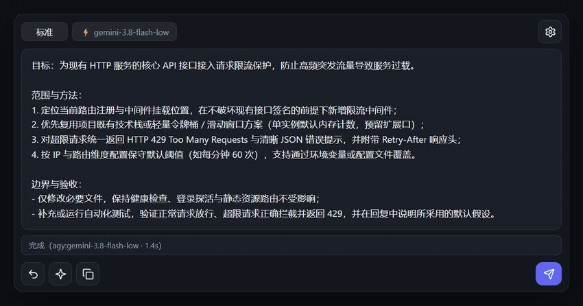
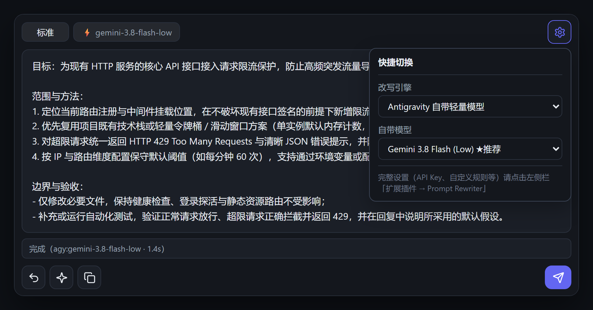
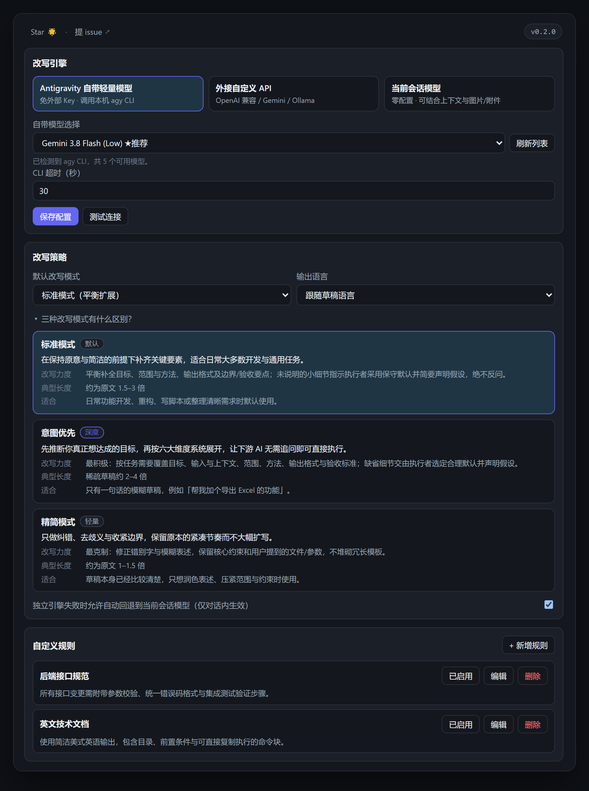

# agy-prompt-rewriter

[English](./README.md) · 简体中文

[](./LICENSE)
[](https://antigravity.google)
[](https://nodejs.org/)
[](./package.json)

把对话里口语化、缺边界的一句话草稿，改写成结构清晰、可直接执行的提示词。**只改写，不执行、不反问**；结果直接落入对话内联可编辑卡片，可当场微调、退回草稿（`↩`）或一键发送执行（`➤`）。

<p align="center">
  
  <br>
  <sub>图 1：内联卡片原地改写、退回草稿（↩）、快捷切换模型（⚙）、复制（📋）与一键发送（➤）</sub>
</p>

- **对话内联卡片 + 纯图标工具栏**：发送 `/prompt-rewriter` 在回复下方直接弹出可编辑卡片，无需来回复制粘贴。
- **三引擎路由 + 快捷切换**：默认调用本机 `agy` 轻量模型改写，不占主会话高阶模型额度；也支持外接 API 或当前会话模型（附带图片 / `@` 附件时自动切换）。
- **零运行期依赖**：仓库已提交 `dist/mcp-server.mjs` 与单文件 `dist/app.html`，克隆启用即可使用。

```text
请帮我安装并启用 Google Antigravity 插件 agy-prompt-rewriter：
1. 将 https://github.com/Bzwlc/agy-prompt-rewriter.git 克隆到本机全局插件目录（macOS/Linux 为 ~/.gemini/config/plugins/agy-prompt-rewriter，Windows 为 %USERPROFILE%\.gemini\config\plugins\agy-prompt-rewriter）；
2. 执行 `agy plugin enable agy-prompt-rewriter` 启用插件；
3. 运行 `agy plugin validate --strict` 校验安装结果并向我汇报状态。
```

**目录**：[30 秒上手](#30-秒上手) · [插件的目的](#插件的目的) · [用法](#用法) · [设置与路由](#设置与路由) · [工作原理与隐私安全](#工作原理与隐私安全) · [常见问题与已知限制](#常见问题与已知限制) · [本地开发](#本地开发)

---

## 30 秒上手

环境要求：**Google Antigravity**（`agy` CLI、Desktop 2.0 或 IDE）与 **Node.js >= 20**。

### 方式一：让 AI 助手自动安装（推荐）

复制下面这段指令发给 Antigravity 或其他 AI 编程助手即可完成安装与校验：

```text
请帮我安装并启用 Google Antigravity 插件 agy-prompt-rewriter：
1. 将仓库 https://github.com/Bzwlc/agy-prompt-rewriter.git 克隆到 Antigravity 全局插件目录：
   - macOS / Linux：`~/.gemini/config/plugins/agy-prompt-rewriter`
   - Windows：`%USERPROFILE%\.gemini\config\plugins\agy-prompt-rewriter`
   （若目录已存在，先确认远端地址并执行 `git pull --ff-only` 更新）
2. 运行 `agy plugin enable agy-prompt-rewriter` 启用插件。
3. 运行 `agy plugin validate --strict <插件目录>` 校验配置与构建产物。
4. 完成后告诉我安装路径、校验结果以及如何用 `/prompt-rewriter` 测试。
```

### 方式二：终端手动全局安装

```bash
# macOS / Linux
git clone https://github.com/Bzwlc/agy-prompt-rewriter.git ~/.gemini/config/plugins/agy-prompt-rewriter
agy plugin enable agy-prompt-rewriter
agy plugin validate --strict ~/.gemini/config/plugins/agy-prompt-rewriter
```

```powershell
# Windows (PowerShell)
git clone https://github.com/Bzwlc/agy-prompt-rewriter.git "$env:USERPROFILE\.gemini\config\plugins\agy-prompt-rewriter"
agy plugin enable agy-prompt-rewriter
agy plugin validate --strict "$env:USERPROFILE\.gemini\config\plugins\agy-prompt-rewriter"
```

> 仓库已附带预构建产物 `dist/mcp-server.mjs` 与 `dist/app.html`，安装时**无需执行 `npm install`**。

### 其他安装方式

- **本地目录安装**：`agy plugin install /path/to/agy-prompt-rewriter && agy plugin enable agy-prompt-rewriter`
- **按项目共享**：将本目录复制到仓库的 `.agents/plugins/agy-prompt-rewriter/` 下即可随仓库分发。

---

## 插件的目的

日常写需求时，一句话草稿往往缺少**目标、输出格式与边界条件**。直接发送给主力模型，要么因为猜测意图导致返工，要么被反问一串问题打断节奏；而为了润色一句话专门消耗主力模型上下文也很浪费。

`agy-prompt-rewriter` 把「写清楚提示词」这一步前置拆出来：用独立轻量模型补全结构并留在可编辑卡片里，确认无误再发给主力模型执行。

**输入草稿**

> `/prompt-rewriter 给接口加个限流，别被刷挂了`

**内联卡片生成结果（标准模式示例）**

> 目标：为现有 HTTP 服务的核心 API 接口接入请求限流保护，防止高频突发流量导致服务过载。
>
> 范围与方法：
> 1. 定位当前路由注册与中间件挂载位置，在不破坏现有接口签名的前提下新增限流中间件；
> 2. 优先复用项目既有技术栈或轻量令牌桶 / 滑动窗口方案（单实例默认内存计数，预留共享存储扩展口）；
> 3. 对超限请求返回 HTTP `429 Too Many Requests` 与清晰 JSON 错误提示，并附带 `Retry-After` 响应头。
>
> 边界与验收：
> - 仅修改必要文件，保持健康检查与静态资源路径不受影响（未指明的阈值与窗口采用保守默认并简要声明假设）；
> - 补充或运行测试，验证正常请求放行、超限请求正确返回 `429`。

- **改完即用，绝不反问**：`sanitizeRewrittenOutput` 会自动剥离多余代码块包裹与末尾追问句，保障提示词可直接执行。

---

## 用法

### 1. 触发方式

- 斜杠命令：`/prompt-rewriter <草稿>`
- 自然语言：`帮我改写提示词：...`、`详细改写 ...`、`精简改写 ...`、`rewrite/polish this prompt: ...`

### 2. 内联卡片控件（`show_rewriter_card`）

<p align="center">
  
  <br>
  <sub>图 2：内联卡片支持下拉切换模式/规则，点击右上角 ⚙ 可原地切换引擎与轻量模型</sub>
</p>

| 区域 | 控件 | 作用 |
| :--- | :--- | :--- |
| 顶部栏 | 模式 / 自定义规则下拉 | 切换 `标准`、`意图优先`、`精简` 或已启用的自定义规则 |
| 顶部栏 | 引擎徽标 | 实时显示当前引擎（如 `⚡ gemini-3.8-flash-low`、`🌐 gpt-4o-mini`、`💬 当前会话模型`） |
| 顶部栏 | `⚙` 快捷切换 | 打开轻量浮层，快速切换引擎、自带模型与默认模式（点击空白或 `Esc` 收起） |
| 编辑区 | 自适应文本框 | 直接微调改写文本，或切回原草稿修改后再改写 |
| 底部栏 | `↩` / `↪` | 退回初始草稿；退回后再次点击可恢复改写结果 |
| 底部栏 | `✨` | 按当前文本框内容与模式原地重新改写；运行中再点一次取消等待 |
| 底部栏 | `📋` | 复制提示词到剪贴板（成功变为 `✓`） |
| 底部栏 | `➤` | 通过 `app.sendMessage` 将最终提示词直接发送到当前对话执行 |

### 3. 三种改写模式对比（示例：`写个脚本清理过期日志`）

| 模式 | 触发词 | 长度变化 | 处理重点 |
| :--- | :--- | :--- | :--- |
| **标准（默认）** | 默认 / `standard` | `1.5×–3×` | 补全目录范围、按修改时间判定阈值、默认 `--dry-run` 安全预览与验证步骤 |
| **意图优先** | `详细改写`、`意图优先`、`deep` | `2×–4×` | 覆盖目标、输入、范围与方法、输出格式、边界与验收标准六大维度（含归档策略、防误删与测试） |
| **精简** | `精简改写`、`简短改写`、`concise` | `1×–1.5×` | 保持紧凑，只收紧「过期天数、写入中日志保护、安全删除」等核心约束 |

---

## 设置与路由

在左侧控制栏点击 **扩展插件 → Prompt Rewriter**（`open_rewriter` 全局入口）可打开完整设置页，配置保存于 `${PLUGIN_DATA}/settings.json`。顶部栏提供 `Star 🌟`、`提 issue ↗` 与当前版本号链接。

<p align="center">
  
  <br>
  <sub>图 3：左侧边栏设置页——三引擎选择、可展开的三模式对比卡片与自定义规则管理</sub>
</p>

### 路由机制

| 引擎 | 大概耗时（估算） | 适用场景与使用建议 | 行为说明 |
| :--- | :--- | :--- | :--- |
| **`agy-cli`（默认）** | 约 `15–22s`（估算，含约 `10s` CLI 冷启动） | 不想配外部 Key 且不想消耗主会话高阶模型额度/上下文时使用；若日常追求更低延迟，建议切到 `external-api` 或 `host-session` | 通过 `agy models` 读取可用模型（默认 `gemini-3.8-flash-low`），每次独立调用 `agy -p` 改写，完全隔离主会话 |
| **`external-api`** | 约 `1–5s`（估算，轻量非思考模型常见 `2–4s`） | **追求极速与高频日常改写首选**——无进程冷启动、无上下文串味；建议选非深度思考的轻量模型（如 Flash / Mini / Haiku / DeepSeek Chat） | 直连 HTTP 接口，支持 OpenAI 兼容（含 Ollama / Magpie）、Google Gemini `:generateContent` 与 Anthropic 原生 `/v1/messages`，支持在线「测试连接」 |
| **`host-session`** | 约 `3–6s`（估算，视当前会话模型而定） | **免配 Key 又希望响应快**，或草稿附带图片、`@` 附件与强上下文依赖时推荐（会消耗主会话 1 轮上下文与额度） | 零配置直接复用当前对话模型改写，可读取当前聊天历史、上传图片与 `@` 引用文件 |

> **图片与附件智能路由**：当 `/prompt-rewriter` 消息附带上传图片或 `@` 引用附件时，为避免纯文本独立通道丢失视觉与上下文信息，Skill 会自动将该次改写交由 `host-session` 直接处理；卡片内点 `✨` 重跑则继续使用当前设置的独立引擎处理文本框内容。

### 持久化配置项

| 配置项 | 默认值 | 说明 |
| :--- | :--- | :--- |
| `engine` | `"agy-cli"` | 改写引擎：`agy-cli` / `external-api` / `host-session` |
| `agyModel` | `"gemini-3.8-flash-low"` | `agy-cli` 使用的模型 ID（支持一键刷新） |
| `agyTimeoutSec` | `30` | `agy-cli` 超时秒数（`5`–`120`） |
| `externalApi.format` | `"openai"` | 协议：`openai`（`/chat/completions`）、`gemini`（`:generateContent`）或 `anthropic`（`/v1/messages`） |
| `externalApi.baseUrl` | `"https://api.openai.com/v1"` | 接口地址（Ollama 可填 `http://localhost:11434/v1`，Magpie 可填 `http://127.0.0.1:3425/v1`） |
| `externalApi.model` | `"gpt-4o-mini"` | 外接模型名称 |
| `externalApi.apiKey` | `""` | 明文密钥或 `env:变量名`（本地免鉴权可留空） |
| `externalApi.timeoutSec` | `20` | 请求超时秒数（`5`–`120`） |
| `defaultMode` | `"standard"` | 默认模式：`standard` / `intent-first` / `concise` |
| `language` | `"auto"` | 输出语言：`auto`（跟随草稿）/ `zh-CN` / `en` |
| `fallbackToHostOnError` | `true` | 独立引擎失败时是否自动回退到当前会话模型 |
| `customRules` | `[]` | 自定义规则（最多 `10` 条，单条 ≤ `4000` 字），支持新增、编辑、启停与删除 |

---

## 工作原理与隐私安全

- **Skill 路由层（[skills/prompt-rewriter/SKILL.md](./skills/prompt-rewriter/SKILL.md)）**：强制只改写不执行、零反问，并执行偏好读取、图片/附件智能路由与失败回退。
- **Stdio MCP Server（[src/server/index.ts](./src/server/index.ts)）**：暴露 `show_rewriter_card`、`open_rewriter`、`get_rewriter_config` 及仅限前端内部调用（`visibility: ["app"]`）的 `app_*` 工具；并通过 [engines.ts](./src/server/engines.ts) 与 [prompt-rules.ts](./src/shared/prompt-rules.ts) 执行调用和输出清理。
- **双视图隔离前端（[src/ui/app.ts](./src/ui/app.ts)、[src/ui/styles.css](./src/ui/styles.css)）**：单文件 `dist/app.html` 分别以 `ui://prompt-rewriter/app.html`（`data-surface="inline"`）和 `ui://prompt-rewriter/settings.html`（`data-surface="global"`）挂载内联卡片与设置页。
- **API Key 永不进上下文**：密钥仅存 `${PLUGIN_DATA}/settings.json`（POSIX `0600`），模型可见响应仅返回掩码（如 `sk-****5678`）或 `env:变量名`，异常日志自动做 `[REDACTED]` 脱敏；前端无任何外链脚本或样式请求。

---

## 常见问题与已知限制

- **点击卡片右上角 `⚙` 为什么弹窗而不是直接跳左侧栏？** Antigravity 的 MCP App 运行在隔离 iframe 中，目前宿主未提供编程式跳转左侧栏扩展页的 API，因此 `⚙` 提供原地切换引擎/模型的轻量浮层，API Key 与自定义规则在左侧栏 **扩展插件 → Prompt Rewriter** 管理。
- **本机未安装 `agy` CLI 怎么办？** 可在设置中切到 `external-api` 或 `host-session`；开启自动回退时，对话内遇到 CLI 错误也会自动切到当前会话模型完成改写。
- **未连接 MCP Server 时还能用吗？** 可以，仅加载 Skill 时会自动退化为输出干净的 Markdown 代码块与确认提示。

---

## 本地开发

```bash
npm install
npm run typecheck                  # TypeScript 严格检查
npm run build                      # 构建 dist/mcp-server.mjs 与 dist/app.html
npm test                           # 运行 MCP 协议、掩码与输出清理单元测试
agy plugin validate --strict .     # 严格校验插件清单、Skill 与 MCP 配置
```

---

## 致谢与开源协议

- Inspired by [huaguoxingkong/dsh-prompt-rewriter](https://github.com/huaguoxingkong/dsh-prompt-rewriter) (built for DeepSeek Harness).
- 本项目采用 [MIT License](./LICENSE) 开源。
